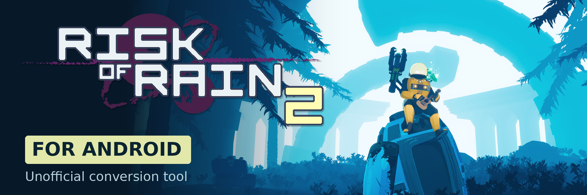

# Risk of Rain 2 for Android

A work-in-progress project to bring Risk of Rain 2 to Android, using game files
from a PC copy you own.

The project converts the original game's code and content so they can run
locally on Android. The game runs on the device itself, rather than streaming
from a PC. This repository contains the tools and instructions for that work;
it does not include the game or replace the need to own it.

## Can I play it yet?

**There is no public download or ready-to-use installer yet.** Development builds
run on test devices, but this is not a finished port. The
[Releases page](https://github.com/danielbuva/ror2-android-port/releases) has no
public player release to install.

Start with the **[player guide](docs/PLAYER_GUIDE.md)** for availability, what
owning the PC game means, and what is still being worked out for installation.

## Where things stand

- The original offline menu, survivor selection and several stage transitions
  have run on Android in developer tests.
- Much of that testing uses automatic input or gameplay assists. A full,
  unassisted run is still unverified.
- In-game audio, the Moon finale, complete controls testing, visual polish and
  sustained performance still need work.
- Installation for players is being researched. There is no confirmed phone-only
  setup process or supported-device list to follow yet.

These are development results, not a promise that the game is ready to play.
The [technical status](PORTING_STATE.md) records the latest verified results and
remaining limits.

## Find your way

| I want to… | Start here |
| --- | --- |
| Find out about playing and installation | [Player guide](docs/PLAYER_GUIDE.md) |
| Follow progress and known limitations | [Current technical status](PORTING_STATE.md) |
| Understand how the conversion works | [Architecture](docs/ARCHITECTURE.md) |
| Set up the development tools or find commands | [Developer guide](docs/DEVELOPING.md) |
| Contribute | [Getting involved](docs/DEVELOPING.md#getting-involved) |
| Explore the work needed before a public alpha | [Public alpha checklist](docs/public-alpha.md) |

This repository contains authored tooling, transformations and reviewed summaries,
plus two promotional-art graphics described in the
[branding and source notes](docs/assets/branding/README.md). Game files and
generated runtime content stay private; the project does not bypass ownership,
authentication or DRM checks.
